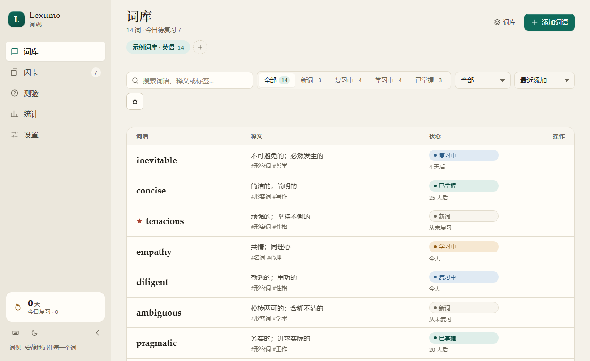

# Lexumo · 词砚

Lexumo（词砚）是一个安静的桌面背单词工作室：把生词研进词砚，用间隔重复一点点记住它们。

项目参考开源桌面词汇应用 **[Lingueez](https://lingueez.app)**（Python + PySide6，作者 Yurii Lysak）的功能理念，用 **Tauri 2 + React 19 + TypeScript + Vite 7** 重新实现。界面以中文为主，视觉基调是暖纸色背景与玉绿色点缀；数据默认全部保存在本机，不注册、不联网即可使用，需要多设备时可选接入自带的同步后端。



> 界面截图。桌面窗口在 150% 缩放的测试机上会被系统二次缩放，为避免排版失真，此图直接取应用前端在 Chromium / WebView2 中渲染后的结果。

## 功能

- **词库管理**：多词库、增删改查、搜索、状态筛选、标签筛选、排序、收藏；每条词条包含主释义、词性、补充释义、例句与例句译文、笔记、标签、音标（词性与释义分开存：释义里不会出现 `n.` 这类前缀，列表和闪卡上词性以小字显示在释义之前）。支持批量操作（全选 / 收藏 / 加标签 / 删除所选）；删除词条后可在提示条上「撤销」，词条与它的复习记录一起回来。
- **添加时自动翻译**：新建或编辑词条时输入单词并失焦，自动查词典填入释义、词性、补充释义、**例句与例句的中文翻译**、音标；可一键「重新翻译」强制覆盖。桌面版通过 Rust 代理查有道词典（音标 + 词性 + 双语例句），网页版降级到有道 / MyMemory / Google 机器翻译链；结果缓存 30 天，命中限流时自动冷却换源，查不到不阻塞手动填写，设置里可整体关闭。**例句译文只会跟着它配套的那句话走**：你自己手写的例句不会被配上词典里另一句的翻译（详见下文「例句」）。
- **间隔重复**：SM-2 变体调度，评分分为 `easy / good / hard`；ease 限制在 `[1.3, 2.5]`，间隔限制在 `[1, 3650]` 天；卡片状态由已获得的间隔推导：`new → reviewing → learning → mastered`。
- **闪卡复习**：四种组卡方式（到期卡片 / 新卡片 / 全部词语 / 收藏词语，各自显示数量）、到期队列 + 新卡队列（受每日新卡上限约束）、翻面后仍保留词形、评分按钮上直接预览「下次间隔」、可随时「撤销上一次」评分或跳过、中途可「结束本轮」、键盘快捷键、自动/手动 TTS 发音。
- **测验**：看词选义 / 看义选词双向模式，4 选 1，即时对错反馈，结束页给出错题列表；测验不写入 SRS。
- **统计**：总词数、已掌握、今日复习、连续天数、每日目标环、状态分布、学习活动柱状图（7 / 30 / 90 天可切换）、评分分布、记忆留存率、逾期词数。
- **设置**：主题（浅色 / 深色 / 跟随系统）、界面语言（简体中文 / English）、每日目标、每日新卡上限、复习顺序、TTS 语速与音色、听力模式、自动翻译开关与翻译缓存管理、账号与同步（服务器地址 / 登录注册 / 自动同步开关 / 立即同步）。
- **导入 / 导出**：JSON 快照、CSV 表格、Anki TXT 三种格式。
- **多端同步（可选）**：仓库自带一个零依赖的 Node 同步后端（`server/`），注册账号后可在多台设备间增量同步词库、词条、复习日志与设置。本地优先：不登录、不联网也能完整使用，登录后离线改动会在恢复网络时自动补推。冲突按 `updatedAt` 后写胜出（LWW），删除以墓碑传播，日志按 id 并集去重。侧栏与设置页实时显示同步状态与待同步条数，可关闭自动同步。
- **本地优先**：IndexedDB 单快照持久化，localStorage 兜底；默认无账号、无遥测，同步是可选的。
- **设计系统**：两套材质，一个外壳。侧栏、连续打卡、手机底部标签栏是「石」——两种主题下都是深色，因为它是放东西的桌面，不是你阅读的表面；每个工作界面是「纸」——浅色主题米白，深色主题深青灰。单一强调色石青只用在三处：你在哪、选中了什么、一次复习走了多远；朱砂只留给不可恢复的删除，所以屏幕上出现红色就意味着要小心。字体按含义分工：IBM Plex Serif 是词条与页标题，IBM Plex Sans 是界面，IBM Plex Mono 是键帽与数字；三款 webfont 自托管（latin 子集共 128 KB），中文回落到系统字体。token 与每条决策的理由记在 `docs/design.md`。
- **界面与可用性**：石与纸双材质、深浅双主题（跟随系统），侧栏可折叠为图标栏，启动骨架屏，词条行悬停才显示操作区，搜索命中高亮；全局快捷键与「?」快捷键帮助；弹窗带焦点陷阱，正文对比度满足 WCAG AA（深浅两套主题的每个页面都实测过）。错误用 `role="alert"` 播报、约 6 秒；成功提示约 3.2 秒，鼠标悬停或聚焦时暂停计时；带「撤销」的提示保留 8 秒。所有提示都能手点关闭。
- **动效**：翻页淡入、列表逐行落位、闪卡两段式翻面、测验对错反馈、按下缩放、提示条进出。全部走系统「减少动态」设置——开启后动画时长归零，闪卡直接出答案，不靠定时器。

## 键盘操作

界面内所有操作都可以用键盘完成，按 <kbd>?</kbd> 随时打开快捷键帮助。

| 按键 | 作用 |
| --- | --- |
| <kbd>Ctrl</kbd>+<kbd>1</kbd> … <kbd>5</kbd> | 切换词库 / 闪卡 / 测验 / 统计 / 设置 |
| <kbd>?</kbd> | 打开或关闭快捷键帮助 |
| <kbd>/</kbd> | 聚焦搜索框（词库页） |
| <kbd>n</kbd> | 新建词条（词库页） |
| <kbd>Space</kbd> | 翻开 / 盖上闪卡 |
| <kbd>1</kbd> <kbd>2</kbd> <kbd>3</kbd> | 闪卡评分（困难 / 记得 / 简单） |
| <kbd>Ctrl</kbd>+<kbd>Z</kbd> | 撤销上一次闪卡评分或跳过 |
| <kbd>←</kbd> <kbd>→</kbd> | 跳过当前卡片 |
| <kbd>A</kbd>–<kbd>D</kbd> 或 <kbd>1</kbd>–<kbd>4</kbd> | 选择测验选项 |
| <kbd>Enter</kbd> | 测验下一题 |
| <kbd>Esc</kbd> | 关闭弹窗 / 清空搜索 |

> 快捷键只有一个来源：`src/lib/shortcuts.ts` 里唯一的 `document` keydown 监听器，配一个守卫函数（输入框 / `contentEditable` / 下拉框内让位，输入法组字中一律不响应）和一份声明式绑定表。作用域优先级只声明一处（弹窗 > 页面 > 全局），帮助面板里的条目由同一份绑定表生成，因此不会出现「帮助里写着、实际按了没反应」。

> 在输入框内输入时，单键快捷键会自动让位，不会误触发；用中文输入法打拼音时（组字过程中）同样不会触发——按 <kbd>n</kbd> 不会在选字途中打开新建词条，<kbd>Space</kbd> 也不会在选字途中翻卡。

## 手机与触屏

界面按窗口宽度自适应，不区分平台——手机浏览器、平板、桌面窗口都走同一套布局。

| 宽度 | 布局 |
| --- | --- |
| ≥ 1000px | 完整侧栏 + 多列列表 |
| 720–1000px | 侧栏收成图标轨道（rail） |
| < 720px | 侧栏隐藏，底部五标签栏导航；弹窗变成底部抽屉 |

触屏适配的几处细节：

- 底部标签栏常驻五个顶级页面，闪卡标签带到期数量徽标；切换页面时滚动位置自动回到顶部。
- 词库行在手机上收成「词形 + 释义（两行截断）+ 状态」三块，行内只保留发音按钮；收藏、编辑、删除移入编辑器。
- 弹窗以底部抽屉呈现，高度不超过视口，操作按钮留在拇指区。
- 表单控件字号固定 16px，避免 iOS 聚焦时强制放大。
- 按钮、开关、滑块、标签的最小触控尺寸按 38–44px 排布，并适配 `safe-area-inset-*`（刘海与手势条）。
- 触屏不依赖 hover：行操作在手机上始终可见，桌面端仍是悬停显示。

## 技术栈

| 层次 | 选型 |
| --- | --- |
| 桌面壳 | Tauri 2（Rust，系统 WebView2 / WebKitGTK / WKWebView） |
| 前端框架 | React 19 |
| 语言 | TypeScript 5.8（`strict` + `noUnusedLocals` + `noUnusedParameters`） |
| 构建 | Vite 7（固定端口 1420，`strictPort`） |
| 测试 | Vitest 3（纯函数用 Node 环境，整应用冒烟测试用 jsdom） |
| 持久化 | IndexedDB（`lexumo` 库，单键快照）+ localStorage 回退 |
| 发音 | Web Speech API（`speechSynthesis`） |
| 查词 / 翻译 | Rust 侧 `reqwest` 代理有道词典 JSON API（桌面）；浏览器降级到有道 `trans` → MyMemory → Google |
| 同步后端 | Node 24（`node:http` + `node:fs`，零第三方依赖），每用户一个 JSON 文件 |
| 同步协议 | 自建 JSON API，见 [`docs/sync-protocol.md`](docs/sync-protocol.md)：增量 `rev`、LWW、墓碑删除、日志并集 |
| 样式 | 原生 CSS（设计令牌 + 全局样式），无 UI 框架 |
| 图标 | Pillow 脚本生成（`src-tauri/icons/generate-icons.py`）：石框 + 纸页 + 石青书脊，几何与理由见 [`docs/icon/README.md`](docs/icon/README.md) |

## 目录结构

```text
.
├── index.html                  # 单页入口，标题「Lexumo · 词砚」
├── package.json                # 脚本：dev / build / preview / test / tauri:*
├── vite.config.ts              # @ → ./src，端口 1420，outDir dist
├── vitest.config.ts            # 测试配置：environment node，@ 别名，包含 .ts/.tsx
├── tsconfig.json               # 前端 TS 配置（strict，include: src）
├── tsconfig.node.json          # vite/vitest 配置文件的 TS 配置
├── LICENSE.txt                 # GNU AGPL-3.0 全文
├── NOTICE                      # 上游署名与 AGPL-3.0 §7(b) 附加条款
├── THIRD-PARTY-LICENSES.md     # 第三方组件许可
├── docs/
│   ├── app-ui.png              # README 界面截图
│   ├── sync-protocol.md        # 同步接口契约（后端与客户端共同的唯一规范）
│   └── usability-round.md      # 一轮可用性审计的记录：改了什么、为什么、怎么验证的
├── server/                     # 自建同步后端（零依赖 Node）
│   ├── package.json            # npm start / npm test
│   ├── README.md               # 部署、环境变量、端点说明
│   ├── src/
│   │   ├── index.js            # HTTP 路由、CORS、body 限制
│   │   ├── auth.js             # 注册/登录/登出、scrypt 口令、令牌
│   │   └── store.js            # 每用户 JSON 落盘与 LWW 合并
│   ├── test/                   # node:test 用例（auth / cors / sync）
│   └── test-utils/             # 临时服务与 curl 冒烟脚本
├── src/
│   ├── main.tsx                # React 挂载 + Provider 组装
│   ├── App.tsx                 # 应用外壳：侧边栏、主题、页面切换
│   ├── app/router.tsx          # 极简 hash 路由
│   ├── components/
│   │   ├── Icon.tsx            # 内联 SVG 图标集
│   │   ├── SessionResult.tsx   # 闪卡/测验共用的结算页（正确率只在这里格式化）
│   │   ├── Modal.tsx           # 焦点陷阱对话框与 ConfirmDialog
│   │   ├── Toast.tsx           # 提示条队列（悬停暂停自动消失）
│   │   ├── TagInput.tsx        # 标签胶囊与行内标签编辑器
│   │   └── ui.tsx              # 其余通用 UI（PageShell / Segmented / Ring / StatTile 等），并再导出上面三个模块
│   ├── i18n/
│   │   ├── index.tsx           # 翻译函数与 Provider；`TFunc` 的 key 被约束为 `MessageKey`
│   │   ├── i18n.test.ts        # 字典自检：两种语言路径一致、无空串、每个 key 都能解析、插值
│   │   └── locales/            # zh-CN.ts / en.ts（结构同构，en 受 Dictionary 约束；zh-CN 导出 MessageKey）
│   ├── lib/
│   │   ├── db.ts               # IndexedDB + localStorage 持久化
│   │   ├── store.ts            # createStore 工厂、可观察快照与全部数据变更
│   │   ├── journal.ts          # 变更日志：pending / tombstones 的唯一写者
│   │   ├── srs.ts              # 间隔重复：调度算术 + 「评分后是什么状态」的唯一决策点
│   │   ├── session.ts          # 学习会话状态机（纯函数，闪卡与测验共用）
│   │   ├── wordIndex.ts        # 词库索引：每库分桶、状态计数、标签池、筛选排序、统计头条
│   │   ├── dayStats.ts         # 今日复习数 / 连续学习天数（纯函数）
│   │   ├── quiz.ts             # 出题（纯函数）
│   │   ├── transfer.ts         # 导入导出：JSON / CSV / Anki TXT
│   │   ├── utils.ts            # id / 日期 / 文本等小工具
│   │   ├── types.ts            # 领域类型与默认设置
│   │   ├── seed.ts             # 首次启动的演示词库与复习历史
│   │   ├── languages.ts        # 语言元数据
│   │   ├── translate.ts        # 查词/翻译：有道解析、多源降级、缓存
│   │   ├── sync.ts             # 同步客户端：会话、增量推送/拉取、自动同步循环
│   │   ├── syncMerge.ts        # 纯函数：收集待推改动、合并远端改动（LWW/墓碑）、一轮同步的结算与合并
│   │   ├── wire.ts             # 同步线格式边界：逐字段重建记录，服务器盖的 _rev 无法回写/回推/进备份
│   │   ├── shortcuts.ts        # 快捷键的单一来源：作用域优先级 + IME 与输入框让位 + 「?」帮助用的定义表
│   │   ├── localChanges.ts     # 无依赖的本地变更事件总线（避免 store ↔ sync 循环）
│   │   └── tts.ts              # 语音合成封装
│   ├── __tests__/
│   │   └── app.smoke.test.tsx  # jsdom 整应用挂载冒烟测试
│   ├── pages/
│   │   ├── words/              # WordsPage.tsx / WordEditor.tsx
│   │   ├── study/              # FlashcardsPage.tsx / QuizPage.tsx
│   │   ├── stats/              # StatsPage.tsx
│   │   └── settings/           # SettingsPage.tsx / SyncSection.tsx / parts.tsx
│   └── styles/                 # tokens.css（设计令牌）+ global.css + 页面级 study.css / insights.css
└── src-tauri/
    ├── Cargo.toml              # tauri 2 / tauri-build 2 / reqwest（查词代理）
    ├── build.rs
    ├── tauri.conf.json         # 窗口、构建命令、bundle 图标
    ├── capabilities/default.json  # Tauri 2 权限能力
    ├── icons/                  # 应用图标 + 生成脚本
    │   ├── icon.png            # 512×512
    │   ├── 32x32.png
    │   ├── 128x128.png
    │   ├── 128x128@2x.png      # 256×256
    │   ├── icon.ico            # 16/32/48/64/128/256 多尺寸（16px 用简化画法）
    │   ├── icon.icns           # macOS 11 个尺寸（16–1024 + @2x）
    │   └── generate-icons.py   # 用 Pillow 重新生成上述图标
    └── src/
        ├── main.rs             # 桌面可执行入口
        └── lib.rs              # Tauri Builder、窗口宿主、lookup_word / translate_text 命令
```

## 开发命令

前置要求：

- Node.js 20+（项目使用 ESM 与 `import.meta.url`）
- Rust 1.77.2+ 与对应平台工具链（仅 `tauri:dev` / `tauri:build` 需要）
- Windows 需要 WebView2 运行时；Linux 需要 `webkit2gtk` 等系统依赖

```bash
# 安装依赖
npm install

# 仅浏览器开发：http://localhost:1420
npm run dev

# 类型检查 + 生产构建，产物在 dist/
npm run build

# 桌面窗口开发（Tauri 会先执行 npm run dev，再打开原生窗口）
npm run tauri:dev

# 打包安装包（会执行 npm run build 并编译 Rust）
npm run tauri:build

# 测试 / 单独类型检查
npm test          # 等价于 npx vitest run
npx tsc --noEmit
```

重新生成应用图标（需要 Pillow）：

```bash
python src-tauri/icons/generate-icons.py
```

> `npm run build` 内部已经包含 `tsc --noEmit`，因此类型错误会阻断构建。Vite 端口固定为 `1420` 且 `strictPort: true`，与 `tauri.conf.json` 的 `devUrl` 保持一致；`src-tauri/**` 已从 Vite 的监听范围中排除。

如果只想得到可执行文件、跳过安装包打包（打包需要联网下载 WiX/NSIS）：

```bash
npx tauri build --no-bundle
# 产物：src-tauri/target/release/lexumo.exe
```


## 测试

```bash
npm test
```

| 文件 | 用例数 | 覆盖内容 |
| --- | --- | --- |
| `src/lib/srs.test.ts` | 65 | 三档评分调度、ease 上下限、间隔上限、状态边界、间隔文案、不可变性；`reviewCard` 的「永不降级」、复习日志字段、`undoGrade` 是评分的精确逆、`previewGrades` 与实际评分一致 |
| `src/lib/translate.test.ts` | 47 | 有道词典 / 机器翻译 / MyMemory / Google 各源解析、词性与义项拆分（主义项不带词性前缀、人名义项被过滤、补充释义限 3 条且换词性才重新标注）、`posTags` 去重、缓存命中、429 降级与冷却、注入的查词适配器与时钟 |
| `src/lib/transfer.test.ts` | 20 | 三种文件格式的进出口：CSV 表头顺序与 RFC 4180 引号、`pos` 与 `exampleTranslation` 两列的导出与导入（各含四个别名）、空值折叠成 `undefined`、BOM 与 CRLF、未知 status 不猜、JSON 快照只恢复词条、Anki 多列合并与 HTML 剥离、无法识别时不抛错 |
| `src/lib/syncMerge.test.ts` | 23 | 待推改动收集、LWW 合并、墓碑删除、日志并集去重 |
| `src/lib/journal.test.ts` | 23 | 用真实 store 实例验证：每次本地编辑都进 pending、删除必留墓碑、删词库级联词与日志、快照不可变、`applyRound` 真的结算、远端改动不算本地编辑 |
| `src/lib/wordIndex.test.ts` | 22 | 每库分桶与状态计数、标签池排序（含同次数 localeCompare 兜底）、到期判定、四种筛选与四种排序、统计头条各数字 |
| `src/lib/shortcuts.test.ts` | 20 | 快捷键的单一来源：作用域优先级（modal > page > app）、输入框内单键让位、修饰键组合仍生效、注册与卸载、`SHORTCUT_HELP` 与真实绑定一致 |
| `src/lib/utils.test.ts` | 20 | 文本归一化、clamp、shuffle、日期差值、dayKey、cx、uid、相对时间 |
| `src/lib/session.test.ts` | 19 | 学习会话状态机：全程进度、hard 算复习但不算答对、skip 语义、undo 双向精确还原、空列表、正确率不为 NaN |
| `src/lib/quiz.test.ts` | 18 | 出题：选项不重复且必含正确答案、同词不重复、词表不足四个时不崩、三种题面模式 |
| `src/lib/wire.test.ts` | 17 | 同步线格式：逐字段重建让服务器盖的 `_rev` 无法回写/回推/进备份、畸形记录被丢弃、`decode/encode` 往返无损、可选文本字段（`phonetic` / `exampleZh`）往返不丢且空串折叠成 `undefined` |
| `src/lib/syncRound.test.ts` | 13 | 一轮同步的结算与合并：发送后结算、在途编辑仍留 pending、远端合并但不算本地编辑、墓碑删除、旧记录 LWW 落败、回声不重复 |
| `src/lib/dayStats.test.ts` | 9 | 今日复习数只算本地午夜之后、连续天数（今天空着不断档、缺一天即停、同一天多次只算一天、跨月不串） |
| `src/__tests__/app.smoke.test.tsx` | 5 | 在 jsdom 中真实挂载整个应用：五个页面渲染、主题切换、弹窗开关、搜索过滤 |
| `src/__tests__/error-paths.test.tsx` | 3 | 两条没有自然归属的失败路径：渲染崩溃由根 ErrorBoundary 接住并换成说明卡片、监听器之间互不牵连、快照两处都写不进去时上报 `store-write` |
| `src/i18n/i18n.test.ts` | 6 | 字典自检：中文/英文路径完全一致、没有空串值、每个键在两种语言里都能解析出文案（不会把键名本身显示给用户）、`{var}` 插值与未知占位符保留 |

共 **330** 个用例。后端另有 `server/` 下的 `node:test` 用例（`cd server && npm test`）。

> 文案的键名在编译期就是强类型的：`TFunc` 只接受 `MessageKey`（从 `zh-CN.ts` 的字典推导出的点路径联合类型）。写错一个键名会在 `tsc` 阶段报 `TS2345`，而不是在界面上静默显示成 `stats.titel`。

冒烟测试通过 `// @vitest-environment jsdom` 单独指定环境，其余用例仍跑在 Node 环境。

## 数据存储

- **主存储**：IndexedDB 数据库 `lexumo`，对象仓库 `kv`，键 `app`，保存**单个版本化快照** `AppData`：

  ```ts
  interface AppData {
    version: number;            // 当前 DATA_VERSION = 2
    lists: WordList[];
    words: Word[];
    logs: ReviewLog[];          // 每次评分的复习日志
    settings: Settings;
    settingsUpdatedAt: number;  // 设置项参与同步时的 LWW 时间戳
    tombstones: Tombstones;     // 已删除的词/词库/日志 id → 删除时间
    pending: PendingChanges;    // 尚未推送到服务器的改动（id 列表）
  }
  ```

- **写入策略**：所有变更走 `store.ts` 的 `commit()`，先通知订阅者，再以 220ms 防抖写入快照。`commit` 只浅拷数组，因此记录一律**替换**而非就地修改（`patchWord` / `patchList`），旧快照不会被后续编辑污染。
- **同步记账**：`pending`（待推改动）与 `tombstones`（删除墓碑）只由 `src/lib/journal.ts` 写入，业务操作不再各自手写 `mark*Dirty`。这样「本地改动必须被推送」「本地删除必须留墓碑」两条不变量由模块保证，新增操作不会漏记账；删词、批量删词、删词库共用同一套级联（`journal.purgeWords`），不会留下孤儿复习日志。
- **一轮同步的顺序**：推送成功后的「先结算已发送、再合并远端」不再写在 `sync.ts` 的调用点，而是由纯函数 `applyRound(data, { sent, received })` 一次完成，store 只暴露单个 `applyRound`。顺序之所以重要，是因为结算带版本守卫——只有当本地记录仍是推送出去的那个版本时才清 `pending`；请求在途期间用户又编辑过，这条记录就保持 pending 进入下一轮。合并属于「服务器在说话」，因此不触发本地变更事件，避免每次推送后再空跑一轮同步。
- **学习会话**：闪卡页与测验页共用 `src/lib/session.ts` 的状态机（当前卡片、进度、正确率、撤销栈），「hard 算复习但不算答对」这条规则与正确率格式化各只有一处实现，两个页面只负责渲染、键盘与调用 `gradeWord` / `undoReview`。
- **复习决策**：`src/lib/srs.ts` 不只算间隔，也拥有「评完这一档之后这张卡是什么状态」的完整决策——`reviewCard(card, grade, now, ids)` 返回 `{ srs, status, log }`，其中状态按「永不降级」规则提升、复习日志在模块内部铸造；`undoGrade(prev, log)` 是它的精确逆（**故意不重算**，否则一张刚失手的已掌握卡片会被降级回去），`previewGrades` 让评分按钮预览的正是将要执行的那条规则。`store.ts` 里只剩持久化与同步记账，因此这条不变量不会再因为出现第二个调用者而被绕开。
- **词库派生**：状态计数、标签池、到期桶、筛选排序与统计头条全部由 `src/lib/wordIndex.ts` 一次遍历产出（`buildWordIndex` / `queryWords` / `summarize`），页面不再各自手写一份。今日复习数与连续天数归 `src/lib/dayStats.ts` 所有，侧栏与统计页读同一份实现。此前词库页表头的到期数是全局的、标签下拉却作用于单个词库，会出现「选了标签却是空列表」这类前后不一致；现在表头、标签下拉与列表都描述同一个词库，侧栏徽标仍保持全局。
- **回退链**：IndexedDB 不可用或读写失败 → localStorage 键 `lexumo:data`（JSON 字符串）→ 再失败则仅保存在内存（刷新即丢失）。
- **线格式边界**：服务器给每条记录额外盖一个 `_rev` 字段，它属于服务器的簿记，不属于词条。`src/lib/wire.ts` 的 `decodeChangeSet` 在边界上逐字段重建领域记录（剥掉 `_rev` 与任何未知键，形状不符的记录直接丢弃而不是抛错），`encodeChangeSet` 负责上行；因此 `_rev` 不会写进快照、不会被下次上传回推、也不会跑进用户的 JSON 备份。备份导出用 `encodeAppData` 只写领域字段（`version` / `lists` / `words` / `logs` / `settings` / `settingsUpdatedAt`），不把 `pending` / `tombstones` 这些同步簿记交给用户。**逐字段重建意味着字段白名单必须完备**：`phonetic` 与 `exampleZh` 都曾在白名单之外，导致音标和例句译文在同步与 JSON 备份两侧被静默剥离——两者现在都在白名单里，且 `wire.test.ts` 对「可选文本字段往返不丢」有专门的用例兜住这类回归。
- **清空数据的传播**：清空会为每个被删的词、词库、日志写墓碑（否则下次登录同步会把「已清空」的数据再拉回来）；唯独默认词库只更新时间戳而不写墓碑——它的 id 是固定值，新快照一定会重建它，写墓碑会让回声删除把刚建好的空词库也删掉，最终一个词库都不剩。
- **版本迁移**：启动时若快照 `version` 低于 `DATA_VERSION`，会就地补齐新字段（`updatedAt` / `tombstones` / `pending` / `settingsUpdatedAt`）并保留原有数据；只有 `version` 高于当前版本（降级运行）才会重新播种。
- **隐私**：数据默认只在本机。只有在「设置 → 账号与同步」中显式登录后，词库、复习日志与设置才会推送到你填写的服务器地址；不登录则没有任何网络上传。

## 导入 / 导出格式

三种格式均为 **UTF-8 文本**。

### JSON（完整快照）

导出整个 `AppData` 对象（含 `version`、词库、词条、复习日志、设置），用于无损备份。

导入时支持两种输入：完整快照对象（读取其 `words` 数组）或直接的词条数组。**导入只恢复词条**，不会覆盖已有的复习日志与设置；缺少 `term` 的行会被跳过。

### CSV（表格）

导出首行为表头，列顺序固定：

```csv
term,pos,definition,definition2,example,exampleTranslation,note,tags,status
serendipity,n.,意外发现美好事物的能力,,a serendipitous meeting,一次机缘巧合的相遇,来自阅读,抽象;名词,reviewing
```

- `tags` 用分号 `;`（也接受全角 `；`）分隔；
- `pos` 是词性，可留空；导入时也认 `part of speech`/`partOfSpeech`/`词性`。释义本身不含词性前缀，两者分开存；
- `exampleTranslation` 是例句的译文，可留空；导入时也认 `example_zh`/`examplezh`/`例句翻译`/`例句译文` 这几个列名；
- 含逗号、双引号或换行的字段按 RFC 4180 用双引号包裹，内部双引号写两遍；
- 导出带 UTF-8 BOM 与 CRLF，便于 Excel 直接打开；
- 导入时表头可用中英文别名（`term`/`word`/`单词`/`词语`、`definition`/`meaning`/`释义`/`意思` 等）；无表头时首列作 `term`。

### Anki TXT

Tab 分隔，第一列是词形，其余列合并为释义，HTML 标签会被剥离：

```text
serendipity	意外发现美好事物的能力	a serendipitous meeting
```

### 导入行为

- 所有导入的词条都会写入**第一个词库**；
- 与目标词库中已有词条重复（按归一化后的词形比较）的行会被跳过，并在结果中提示跳过数量；
- 导入前会显示预览（识别出的格式、条数、跳过数、前 8 个词条），确认后才写入。

## 例句

例句不是一个单独的字段，而是**一对**：`example`（原句）与 `exampleZh`（它的译文）。

- **自动填**：查词时把词典返回的第一组双语例句一起填进来。桌面版的有道 `jsonapi` 会给 3 组，取第一组；网页版那条链拿不到例句，只填释义。释义已经填过、只有例句是空的时候也会补，所以编辑旧词条同样能用。
- **只在空位填**：自动档只填空字段，不覆盖你已经打上去的字；「重新翻译」按钮（以及 `Ctrl/⌘+Enter` 之外的显式点击）才强制覆盖。
- **译文跟着它自己的那句话**：如果卡片上的原句已经被你换成自己写的，词典的译文就不会再贴上来——两张互不相关的句子拼在同一张卡上比没有译文更糟。界面上这时只显示原句输入框，译文框不出。
- **闪卡背面**：原句与译文分两行显示，原句斜体，译文字号小一档、颜色淡一档。空白译文不占位。
- **导入导出**：CSV 有 `exampleTranslation` 列，JSON 快照里是 `exampleZh`，两者都会随同步传播。

> 为什么不用 Tatoeba：`tatoeba.org` 不发任何 CORS 头，浏览器端只能靠 Rust 代理；它的官方 API 有 CORS 但**不返回配对的译文**（`trans` 系列参数一律 400，单条记录的 `/translations` 端点 404），而中文句子覆盖也稀疏——常用词有 10 条，`resilient` / `ubiquitous` / `serendipity` 这类恰好是你要背的词却是 0 条。再加上单次查询 7–30 秒的延迟，它不适合做「输入单词就自动填」这条同步路径。有道那 3 组中英对照是查词时本来就已经下载到本地的数据，此前只是解析后丢掉了译文。

## 多端同步

同步是**可选的**：不登录时应用与单机版完全一致。需要多设备共享时，自己跑一个后端即可——不需要任何云服务商。

### 1. 启动后端

```bash
cd server
npm start
# 默认 http://127.0.0.1:8787，数据写在 server/data/
```

零第三方依赖，只需要 Node 20+。`PORT` / `HOST` / `DATA_DIR` 三个环境变量可调；想让手机和电脑都连上，把 `HOST` 设为 `0.0.0.0` 并用局域网 IP 访问。详见 [`server/README.md`](server/README.md)。

### 2. 在应用里登录

打开「设置 → 账号与同步」：

1. 服务器地址填后端地址（例如 `http://192.168.1.10:8787`），可先点「测试连接」；
2. 填邮箱与密码，首次点「创建账号」，之后在别的设备上点「登录」；
3. 登录成功后会自动推一次本地改动并拉取服务器上的数据。

登录后侧栏底部会出现同步状态（已同步 / 同步中 / 同步失败 / 待同步条数），点它可直接跳到设置页。默认开启自动同步：本地编辑后 2.5 秒防抖推送、每 15 秒轮询一次未推送的改动、窗口重新获得焦点或网络恢复时立即同步。也可以手动点「立即同步」。

### 3. 冲突与删除的处理

- **词条与词库**：整条记录同步，按 `updatedAt` 后写胜出（LWW）。本地有未推送的改动且比服务器上的更新时，保留本地版本并在下一轮推送。
- **复习日志**：只追加，按 `id` 去重做并集，不会互相覆盖；撤销评分时会写入日志墓碑，让删除也能传播。
- **删除**：写墓碑（`{ id, updatedAt, deleted: true }`）而不是直接抹掉，否则离线设备下次同步会把删掉的词再推回来。
- **设置**：整体按 `settingsUpdatedAt` 做 LWW。
- **首次登录**：本地已有的词库（包括首次启动的示例词库）会整批上传，所以新设备登录后能看到全部内容。

接口契约见 [`docs/sync-protocol.md`](docs/sync-protocol.md)，客户端 `src/lib/sync.ts` 与后端 `server/` 都以它为准。

## 已知限制

- **平台**：以 Windows 为主进行开发；macOS / Linux 打包未验证。`icon.icns` 已生成（11 个尺寸，16–1024 加 @2x），但未在 macOS 上实机验证过 Dock 与 Finder 的显示效果。
- **图标**：由 `src-tauri/icons/generate-icons.py` 用 Pillow 生成，不依赖任何外部素材与字体（图形全部是几何与圆角矩形）。**16px 用的是另一套简化画法**：石头墙加厚、书脊放大 1.55 倍、去掉纸上的墨点，否则那三个细节在 16px 会抗锯齿成一团灰。`.ico` 与 `.icns` 容器是脚本手写拼装的，因为 Pillow 的写入器只会把单张图缩放塞进每个槽位，会丢掉简化画法。
- **安装包**：`cargo build --release` 已在 Windows 上通过，产物 `src-tauri/target/release/lexumo.exe`（约 12.9 MB）可正常启动并显示窗口。<br>`cargo check` 在最后一次收尾时**未能复现**：`vswhom-sys` 的构建脚本调用 VS2019 BuildTools 的 `cl.exe` 编 `ext/vswhom.cpp` 失败（同一环境此前通过过，属工具链差异，与代码无关；`cargo build --release` 与 `npx tauri build --no-bundle` 都正常完成，说明 Rust 代码本身没问题）。<br>另外 `npm run tauri:build` 的**打包步骤**未能在本环境完成：Tauri 需要从 GitHub Releases 下载 WiX（MSI）或 NSIS（EXE 安装器），该域名在开发环境中超时。二进制本身没有问题，在能访问 GitHub 的机器上重跑即可产出安装包；或先用 `npx tauri build --no-bundle` 只产出可执行文件。
- **自动翻译**：依赖有道词典 / MyMemory 等公开接口，需联网；接口可能限流或变更，届时查词会降级或提示失败，不影响手动录入。缓存 30 天，设置里可清除。
- **视觉验证**：功能层有 330 个单元 / 冒烟用例；界面另有基于 headless Edge + DevTools 协议的可重复校验脚本（`.shots/`，不随仓库分发），把「看起来对」换成实测数字：五个页面在浅色与深色下的全部文本节点对比度（WCAG AA，0 处不达标，并用一个故意做坏的节点反向验证这套扫描确实能报错）、统计柱状图在 1280 / 760 / 390px 三种宽度 × 7 / 30 / 90 天区间下轴标签不裁切不重叠、手机布局无横向溢出且触控目标 ≥ 40px、提示条不被底部标签栏遮挡、批量选择与撤销删除的完整流程、输入框内打字不触发单键快捷键、以及页面上不残留任何未翻译的 i18n 键；动效则逐条断言 computed `animation-name` / 延迟、翻面过程中途的 `transform` 矩阵、以及模拟「减少动态」后动画确实归零。另用 Hallmark 的 `sloplint`（app 作用域 + 渲染层，7 种宽度 × 5 个页面共 25 张截图）做结构与反模板自检，结果为 0 FAIL / 0 WARN / 1 已记录豁免 / 2 已作答；以及 19 条 DOM 断言，确认石与纸两套材质、强调色、字体、焦点环、控件高度和 320–1920px 无横向溢出确实落到了屏幕上。另有一条把 IndexedDB 与 localStorage 同时写坏的探针，确认写不进去时会弹出说明后果与下一步的提示条、界面不崩；渲染崩溃则由根 ErrorBoundary 换成一张说明卡片。未做跨平台像素级视觉回归，也没有接入 CI。
- **TTS**：依赖系统语音合成引擎，可用音色与语言随平台而异；部分语言可能没有可用语音，此时听音功能静默降级。
- **同步**：自带的后端是单进程、每用户一个 JSON 文件的实现，适合个人或小规模自建；不支持集群、无数据库、无备份策略。传输默认是明文 HTTP（本机或局域网内使用没问题，暴露到公网请自行在前面加 HTTPS 反向代理）。令牌存在 localStorage，有效期 30 天。改名前的旧本地数据不会自动迁移（存储键已随应用改名更换）。
- **规模**：采用「全量快照 + 防抖写盘」，词条量很大（约 2 万以上）时每次写入会有可感知延迟。同步也是整条记录增量传输，单次最多 5000 条改动。
- **导入编码**：仅支持 UTF-8，GBK 等编码需先转码；Anki 的 `.apkg` 包不在支持范围内。
- **搜索**：前端内存过滤，无分词与模糊匹配，也不支持正则。

## 致谢与许可

- **功能与交互理念**参考 **[Lingueez](https://lingueez.app)**（作者 Yurii Lysak，AGPL-3.0）。Lexumo 是独立重写，但保留了「词条状态阶梯 + 间隔重复 + 听音记忆」这一核心思路。
- **许可**：本项目以 **GNU AGPL-3.0** 授权，是 Lingueez 的衍生重写，许可证全文见 [`LICENSE.txt`](LICENSE.txt)。
- **署名（AGPL-3.0 §7(b) 附加条款）**：按上游 [`NOTICE`](NOTICE) 的要求，必须在用户可见的法律声明中保留 **“Lingueez — created by Yurii Lysak”** 这一署名。该署名已展示在应用「设置 → 关于」中，请勿移除。
- **第三方组件**：React、Vite、Tauri 等依赖的许可见 [`THIRD-PARTY-LICENSES.md`](THIRD-PARTY-LICENSES.md)。
- **图标**：由 `src-tauri/icons/generate-icons.py` 使用 Pillow 生成，全部是几何图形（圆角矩形 + 圆点），不含任何字体字形或第三方素材，可自由随项目分发。
