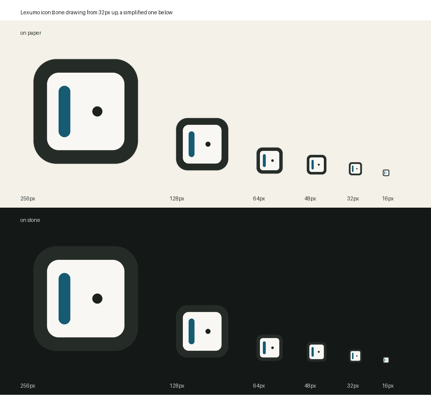

# Lexumo icon

The icon is the app's own two-material shell, shrunk: a dark stone frame holding
a sheet of unbleached paper, with an azurite spine down the left edge and one
ink dot on the sheet for the word currently being learned. Nothing in it is
drawn from outside the design system — every colour is a token, and the icon
reads the same way `docs/design.md` describes the interface.

Generated by `src-tauri/icons/generate-icons.py`; run it from that directory to
regenerate every file. `python generate-icons.py --check` prints the geometry
for both the full and the simplified drawing without writing anything.



## Geometry (1024 canvas)

| | value | share |
| --- | --- | --- |
| canvas | 1024 × 1024 | — |
| frame (stone) | 819 × 819 | 80.0% of canvas |
| frame margin | 102 each side | 10.0% of canvas |
| frame radius | 180 | 22.0% of the frame |
| stone wall (visible rim) | 106 | 13.0% of the frame |
| paper sheet | 607 × 607 | 59.3% of canvas |
| paper radius | 91 | 15.0% of the paper |
| spine (azurite bar) | 91 wide × 401 tall | 15.0% of the paper wide |
| spine position | x 299, y 311–712 | inset 15% / 17% of the paper |
| dot (ink) | 79 diameter | 13.0% of the paper |

The rim is deliberately thick. Below about 12% of the frame the stone vanishes
at 16 px and the icon reads as a plain white square with a blue line in it.

The simplified drawing keeps the same frame and radius but trades detail for
weight: the wall thickens to 143 px (the paper shrinks to 533), the spine grows
to 124 px wide, and the dot is gone (`dot_d = 0`).

## Two drawings, not one

`size < 32` renders a **simplified** variant: the stone wall thickens to 0.045
of the frame, the spine grows 1.55× and the dot is dropped. At 16 px the real
geometry leaves a 1.4 px spine and a 1.2 px dot, which antialias into mud. The
16 px frame therefore shows a heavier bar and no dot at all; everything from
32 px up uses the full drawing.

That is also why the `.ico` and `.icns` containers are written by hand rather
than by Pillow: Pillow's writers take one image and rescale it into every slot,
which would throw the simplified drawing away.

## Palette

| role | token | hex | contrast |
| --- | --- | --- | --- |
| frame, spine | `--frame` | `#252c28` | 13.36:1 against paper |
| spine | `--accent` | `#175b72` | 7.07:1 on paper |
| paper | `--bg` | `#f9f7f3` | — |
| dot | `--ink` | `#1e221e` | 15.07:1 on paper |
| paper edge | `--line` | `#e0ded7` | — |

Measured on the 512 master, counting every opaque pixel: stone 43%, paper 50%,
azurite 5%, ink 1% (the rest is antialiasing between them). So azurite sits at
the edge of the "under 5% of any viewport" rule the design system sets for the
accent — the spine is the one place the accent is allowed to be a large shape,
because at icon size it is a structure, not a highlight. `--accent-ink` `#083747`
and `--frame-accent` `#82c8d4` are for text and in-app strokes; neither belongs
in the icon.

## Platform notes

- **Windows** — the `.ico` carries 16/32/48/64/128/256. The taskbar and Alt-Tab
  pick by size, so the simplified 16 px frame is what shows in the title bar.
- **macOS** — `icon.icns` carries 11 chunks (16 through 1024 plus the @2x
  variants). System convention insets the artwork inside an 824 × 824 content
  area rather than filling the canvas; the 10% frame margin lands close enough
  that the app looks native without a separate macOS build.
- **Linux** — the PNGs from `128x128.png` up are used directly.

## Regenerating

```sh
cd src-tauri/icons
python generate-icons.py           # writes icon.png, 32x32, 128x128, @2x, .ico, .icns
python generate-icons.py --check   # prints geometry, writes nothing
```

`tauri.conf.json` lists `.icns` alongside the PNGs and the `.ico`, so all three
platform bundles take their icon from the same run.
