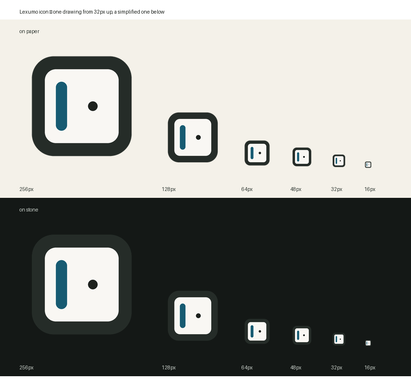

# Lexumo icon

The icon is the app's own two-material shell, shrunk: a dark stone frame holding
a sheet of unbleached paper, with an azurite spine down the left edge and one
ink dot on the sheet for the word currently being learned. Nothing in it is
drawn from outside the design system — every colour is a token, and the icon
reads the same way `docs/design.md` describes the interface.

Generated by `flutter/tool/generate_icons.py`; run it from the repository root to
regenerate every file. `--check` prints the geometry for both the full and the
simplified drawing without writing anything.



## Geometry (1024 canvas)

| | value | share |
| --- | --- | --- |
| canvas | 1024 × 1024 | — |
| frame (stone) | 819 × 819 | 80.0% of canvas |
| frame margin | 102 each side | 10.0% of canvas |
| frame radius | 180 | 22.0% of the frame |
| stone wall (visible rim) | 106 | 13.0% of the frame |
| paper sheet | 607 × 607 | 59.3% of canvas |
| paper radius | 91 | 15.0% of the paper |
| spine (azurite bar) | 91 wide × 401 tall | 15.0% of the paper wide |
| spine position | x 299, y 311–712 | inset 15% / 17% of the paper |
| dot (ink) | 79 diameter | 13.0% of the paper |

The rim is deliberately thick. Below about 12% of the frame the stone vanishes
at 16 px and the icon reads as a plain white square with a blue line in it.

The simplified drawing keeps the same frame and radius but trades detail for
weight: the wall thickens to 143 px (the paper shrinks to 533), the spine grows
to 124 px wide, and the dot is gone (`dot_d = 0`).

## Two drawings, not one

`size < 32` renders a **simplified** variant: the stone wall thickens to 0.045
of the frame, the spine grows 1.55× and the dot is dropped. At 16 px the real
geometry leaves a 1.4 px spine and a 1.2 px dot, which antialias into mud. The
16 px frame therefore shows a heavier bar and no dot at all; everything from
32 px up uses the full drawing.

That is also why the `.ico` container is written by hand rather than by Pillow:
Pillow's writer takes one image and rescales it into every slot, which would
throw the simplified drawing away.

## Palette

Every value is a token in `flutter/lib/ui/core/tokens.dart` (`Palette`), not an
invented colour.

| role | token | hex | contrast |
| --- | --- | --- | --- |
| frame, spine | `Palette.frame` | `#252c28` | 13.36:1 against paper |
| spine | `Palette.accent` | `#175b72` | 7.07:1 on paper |
| paper | `Palette.bg` | `#f9f7f3` | — |
| dot | `Palette.ink` | `#1e221e` | 15.07:1 on paper |
| paper edge | `Palette.line` | `#e0ded7` | — |

Measured on the 512 master, counting every opaque pixel: stone 43%, paper 50%,
azurite 5%, ink 1% (the rest is antialiasing between them). So azurite sits at
the edge of the "under 5% of any viewport" rule the design system sets for the
accent — the spine is the one place the accent is allowed to be a large shape,
because at icon size it is a structure, not a highlight. `Palette.accentInk`
`#083747` and `Palette.frameAccent` `#82c8d4` are for text and in-app strokes;
neither belongs in the icon.

## Platform notes

The Flutter app ships on Windows and Android, which is what the script writes.

- **Windows** — `flutter/windows/runner/resources/app_icon.ico` carries
  16/32/48/64/128/256. The taskbar and Alt-Tab pick by size, so the simplified
  16 px frame is what shows in the title bar.
- **Android** — the five `flutter/android/app/src/main/res/mipmap-*/ic_launcher.png`
  (48 / 72 / 96 / 144 / 192 px) are the launcher icons. Android picks the density
  bucket, so a 16 px simplification never appears.
- **macOS / Linux** — not targets of this app and never built. The script emits
  no `.icns`; should a macOS build ever happen, it would need one added back and
  would want the 824 × 824 content-area inset noted above.

## Regenerating

```sh
python flutter/tool/generate_icons.py           # writes the .ico and the five mipmap PNGs
python flutter/tool/generate_icons.py --check   # prints geometry, writes nothing
```

Needs Pillow. Run from the repository root (or anywhere — the script resolves its
own paths); it writes into `flutter/`, not next to itself.

The `.ico` comes back **byte-identical**. The Android PNGs come back **pixel-
identical but byte-different**, because Pillow's PNG encoder has changed since
they were committed — the decompressed image data matches, the file framing does
not. So verify icon regeneration by comparing pixels, never file hashes. On a
clean tree a regeneration is a no-op in git terms apart from those PNG bytes, and
nothing regenerates the icons during a build.
